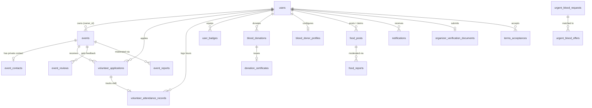

# SERVEO — Complete Product, Technical, Design, Schema & Workflow Documentation

**Version:** `2026-11-28`  
**Platform:** SERVEO Community Public-Welfare Events & Civic Action Platform  
**Operator:** SERVEO Community Initiative (`Nivesh Kumar Tyagi` & Team · ABES Institute of Technology, Ghaziabad, UP, India)  
**Primary Codebase:** `backend/server.js`, `backend/db.js`, `backend/auth.js`, `backend/schema.sql`, `client/src/`

---

## Table of Contents

1. [Product Requirements Document (PRD)](#1-product-requirements-document-prd)
2. [Technical Requirements Document (TRD)](#2-technical-requirements-document-trd)
3. [App & Web Flow](#3-app--web-flow)
4. [UI/UX Design Brief](#4-uiux-design-brief)
5. [Backend Database Schema & Implementation Plan](#5-backend-database-schema--implementation-plan)
6. [Complete Project Workflows (How Everything Works)](#6-complete-project-workflows-how-everything-works)

---

## 1. Product Requirements Document (PRD)

### 1.1 Vision & Problem Statement
Grassroots public-welfare initiatives across India—blood donation camps, free health checkups, surplus food rescue, disaster relief, animal rescue, and environmental cleanups—suffer from a **visibility and trust crisis**. Announcements are fragmented across private WhatsApp groups and paper posters, causing low volunteer turnout, delayed emergency blood matching, food spoilage before NGOs can claim surplus meals, and reluctance to participate due to unverified listings.

**SERVEO** solves this by centralizing verified civic initiatives onto a real-time, location-aware discovery and coordination platform connecting citizens, verified organizers, hospitals, blood banks, restaurants, and NGOs.

### 1.2 Target Personas
| Persona | Role in SERVEO | Primary Goals | Key Routes |
| :--- | :--- | :--- | :--- |
| **Citizen / Volunteer** | `role: 'volunteer'` (`organization_type IS NULL`) | Discover nearby drives (`0–5 km` or `25 km+` Premium), RSVP, track verified hours, earn free milestone badges, download PDF certificates | `/`, `/events`, `/map`, `/event/:id`, `/my-hours`, `/blood-donation` |
| **Organizer / Host** | `role: 'organizer'` (`organizer`, `ngo`, `hospital`, `blood_bank`, `restaurant`, `orphanage`) | Publish drives, upload verification credentials, manage volunteer attendance check-in/out, earn Milestone Star Tiers, equip Specialist Badges | `/organizer`, `/post-event`, `/badges`, `/food-donation` |
| **Platform Admin** | `is_admin = true` | Review organizer verification documents, moderate reported events/food posts, activate Emergency Disaster Mode, inspect demand heatmaps | `/api/admin/*` |

### 1.3 Core Value Propositions & Functional Requirements
1. **Proximity Discovery & Live Map:** Filter events by category (`blood`, `medical`, `food`, `disaster`, `animal`, `environment`, `education`, `tech`, `seminar`, or custom `other`), urgency (`live`, `critical`, `upcoming`), text search, and Haversine radius (`5 km` standard, `25–100 km+` Premium).
2. **Real-Time Live Feed:** Instant volunteer RSVP updates and newly posted event broadcasts over Server-Sent Events (`/api/events/stream`).
3. **Trust & Safety Engine:** Document-based organization verification (`pending` → `approved` / `rejected`) and automated **2-strike false-alarm governance** that bans organizers after 2 distinct `false_alarm` reports.
4. **Urgent Blood Matching & Eligibility:** 90/120-day cooldown tracking, verified blood-bank stock boards, expanding-wave donor notifications, and verifiable PDF donation certificates.
5. **Surplus Food Rescue:** Time-bounded safe pickup windows (`cooked_at`, `pickup_by`, `FOOD_SAFE_HOURS`), atomic single-claim locking, and dual-party handover confirmation (`confirm-pickup` + `confirm-received`).
6. **Verified Volunteer Hours & Gamification:** Check-in/check-out time bounds enforcing authentic hours, verifiable PDF transcripts, 6 free volunteer achievement badges, 6 free Organizer Star Tiers (`5` to `500+` events), and collectible paid Specialist Badges (`₹49–₹139`).
7. **Legal, Privacy & DPDP Act (2023) Compliance:** Mandatory versioned Terms acceptance, Cookie Consent Banner, Resend email unsubscribe, Age `18+` / Parent-Guardian consent gate, and self-service Data Deletion / Account Erasure.

### 1.4 Non-Functional Requirements
- **Performance:** Vite production bundle with lazy-loaded images; 15-minute API rate limiting (`1000 req` global, `20 req` auth, `5 req` OTP sends).
- **Resilience:** Dual-mode DatabaseManager—connects to PostgreSQL (Supabase pooler in production/dev) and falls back seamlessly to an embedded JSON store (`backend/data/serveo-db.json`) if PostgreSQL is unreachable or in `SERVEO_TEST_MODE=true`.
- **Accessibility:** Keyboard navigation, `:focus-visible` outlines, skip-to-content link, `Escape`-dismissible dialogs, `role="dialog"` + `aria-modal`, descriptive image `alt` text.
- **Mobile & Desktop Compatibility:** Responsive from `360px` portrait mobile (floating bottom nav + hamburger drawer) through tablet (`640px–1023px`) to desktop (`≥ 1024px` collapsible icon rail) plus landscape short-viewport media rules (`max-height: 520px`).

---

## 2. Technical Requirements Document (TRD)

### 2.1 System Architecture Overview
SERVEO uses a unified monolith-friendly architecture where the Node.js/Express backend serves both the `/api/*` JSON/SSE/PDF endpoints and the static Vite-built React SPA (`client/dist`), enabling single-container Docker deployment and consistent SSR SEO tag injection.

```
[ Browser / PWA ]
   ├── React 18 SPA (Vite 5, React Router v6, Lucide Icons, Mapbox GL JS)
   ├── Service Worker (/sw.js) & Web App Manifest (/manifest.json)
   └── Real-time EventSource (/api/events/stream)
          │
          ▼ HTTP/HTTPS (Port 3002, Helmet CSP, CORS, Cookie-Parser)
[ Express.js Backend (backend/server.js) ]
   ├── Auth & Cryptography (backend/auth.js): JWT Cookies, bcryptjs, SHA-256 OTP, HMAC Unsubscribe
   ├── PDF Engine (pdfkit): Donor Certificates & Volunteer Hours Transcripts
   ├── SEO HTML Injector: Per-route <title>, canonical, OpenGraph, Twitter, JSON-LD, sitemap.xml
   ├── Resend SDK (resend): Branded 6-digit Email OTP delivery
   ├── Twilio Verify REST (optional): Real SMS OTP (with in-memory SHA-256 OTP fallback)
   └── DatabaseManager (backend/db.js)
          ├── Primary: PostgreSQL (`pg` Pool -> Supabase Pooler, schema.sql)
          └── Fallback: Atomic JSON store (`backend/data/serveo-db.json`)
```

### 2.2 Technology Stack & Dependencies
| Layer | Package / Tool | Purpose |
| :--- | :--- | :--- |
| **Frontend Runtime** | `react` (`^18.3.1`), `react-dom`, `react-router-dom` (`^6.28.0`) | Client SPA & routing |
| **Build Tooling** | `vite` (`^5.4.11`), `@vitejs/plugin-react` | Bundling & asset compilation to `client/dist` |
| **Maps & Icons** | `mapbox-gl` (`^3.8.0`), `lucide-react` (`^0.469.0`) | Interactive geospatial map & UI icons |
| **Backend Server** | `express` (`^4.19.2`), `cors`, `cookie-parser` | REST API, SSE streaming & static SPA hosting |
| **Security** | `helmet` (`^7.1.0`), `express-rate-limit` (`^7.1.5`), `bcryptjs`, `jsonwebtoken` | CSP headers, rate limiters, password hashing, `serveo_token` JWT |
| **Email & PDFs** | `resend` (`^6.41.0`), `pdfkit` (`^0.20.2`) | 6-digit OTP email delivery & A4 verifiable PDF certificates |
| **Database** | `pg` (`^8.11.5`) + `backend/schema.sql` | Relational PostgreSQL + automatic schema/index migration |

### 2.3 Security & Privacy Controls
- **Authentication Cookie:** `serveo_token` signed with `JWT_SECRET` (30-day TTL), stored in `HttpOnly`, `SameSite=Lax` cookie (`Secure` controlled by `COOKIE_SECURE`).
- **OTP Security (`backend/auth.js`):** 6-digit codes generated with `crypto.randomInt(100000, 1000000)`, hashed with `SHA-256(key:code)`, verified using `crypto.timingSafeEqual`, max `5` attempts, `10-minute` TTL.
- **Brute-Force Lockout:** `POST /api/auth/login` locks out an identifier for `15 minutes` after `5` failed password attempts.
- **Content Security Policy (Helmet):** Restricts scripts, styles, fonts, images, frames, and `connect-src` explicitly to `'self'`, Mapbox, Google Fonts, Unsplash, and configured origins.
- **Private Uploads (`private_verification/`):** Verification documents (PDF/JPG/PNG up to 5 MB) are validated by **magic-byte signatures**, saved outside web root with mode `0o600`, and served only to admins (`requireAdmin`) via strict `path.resolve` traversal guards.
- **PII Protection:** Event contact numbers (`/api/events/:id/contact`) require authentication; food pickup contacts (`/api/food-posts/:id`) are withheld until claimed by the winning verified recipient or viewed by the posting restaurant.

### 2.4 Environment Variables
| Variable | Required? | Purpose |
| :--- | :--- | :--- |
| `JWT_SECRET` | **Fatal if missing** | Signs JWT session cookies and HMAC email unsubscribe tokens |
| `DATABASE_URL` | Recommended | PostgreSQL / Supabase connection string (falls back to local JSON if unreachable) |
| `SERVEO_PORT` / `PORT` | Optional (`3002`) | Express listening port |
| `RESEND_API_KEY` | Recommended | Enables real Email OTP delivery via Resend (`EMAIL_FROM` optional) |
| `TWILIO_ACCOUNT_SID`, `TWILIO_AUTH_TOKEN`, `TWILIO_VERIFY_SERVICE_SID` | Optional | Enables live SMS delivery (otherwise OTP is generated & logged on server) |
| `VITE_MAPBOX_TOKEN` | Build-time | Mapbox public token baked into Vite bundle for `/map` |
| `SITE_URL` / `ALLOWED_ORIGINS` | Optional | Origin resolution for CORS, SEO canonicals, sitemap & email unsubscribe links |
| `SERVEO_BUSINESS_*` / `SERVEO_SUPPORT_EMAIL` | Optional | Customizes `/api/legal/contact` business & grievance contact metadata |

---

## 3. App & Web Flow

### 3.1 Master User & Navigation Flow
```mermaid
flowchart TD
    A[Visitor Opens SERVEO] --> B{Terms Accepted?}
    B -- No --> C[TermsGateModal: Expand & Scroll to Bottom]
    C --> D[POST /api/terms/accept]
    D --> E{Cookie Consent Saved?}
    B -- Yes --> E
    E -- No --> F[CookieConsentBanner: Accept All / Essential Only / Customize]
    E -- Yes --> G[Explore Feed / Home]
    F --> G

    G --> H[Discover Events & Filter Category / City / Distance]
    G --> I[Live Interactive Map /map]
    G --> J[Event Detail /event/:id]
    J --> K[Volunteer RSVP + Age Consent]
    J --> L[Reviews / False-Alarm Report]

    G --> M{Signed In?}
    M -- No --> N[Unified Auth Portal /login]
    N --> N1[Sign In: Volunteer or Organization]
    N --> N2[Register: Resend Email OTP +91 Mobile OTP + Age/Guardian Consent]
    N2 --> O[Authenticated Session Cookie]
    N1 --> O

    O --> P{Role?}
    P -- Volunteer --> Q[Blood Center / Urgent Blood / My Hours & Free Badges]
    P -- Organizer --> R[Organizer Portal /organizer]
    R --> R1[Upload Verification Doc]
    R --> R2[Post Event /post-event]
    R --> R3[Mark Attendance Check-In & Check-Out]
    R --> R4[Badges Shop /badges & Premium /premium]
    R --> R5[Food Rescue /food-donation]

    G --> S[Footer & Legal Pages]
    S --> S1[/privacy + Data Deletion Request]
    S --> S2[/terms · /refund-policy · /cookies · /licenses]
    S --> S3[/unsubscribe]
```

### 3.2 Complete Route Map
| Route | Page / Component | Access | Purpose |
| :--- | :--- | :--- | :--- |
| `/` | `HomePage` | Public | Hero overview, nearby/live carousel, popular verified communities, impact strip |
| `/events` | `EventsPage` | Public | Filterable catalog by category, urgency, search query, and distance |
| `/map` | `MapPage` | Public | Interactive Mapbox GL JS map with radius circle, markers, and popups |
| `/event/:id` | `EventDetailPage` | Public (Contact Auth) | Full event overview, Google Maps routing, volunteer RSVP, reviews & reports |
| `/login` | `LoginPage` | Public | Unified Sign In + Dual-Verified Registration (Volunteer or Organization) |
| `/post-event` | `PostEventPage` | Authenticated | Publish new welfare drive (map pin or manual state/district/pincode) |
| `/organizer` | `OrganizerPage` | Authenticated | Manage hosted events, verification doc upload, attendance desk, star tier tracker |
| `/blood-donation` | `BloodDonationPage` | Public / Auth | Donor eligibility screening, 90/120-day cooldown tracker, blood stock, donor leaderboard |
| `/urgent-blood` | `UrgentBloodPage` | Public / Auth | Post urgent hospital requests & accept compatible donor calls |
| `/food-donation` | `FoodDonationPage` | Public / Auth | Verified restaurants post surplus meals; verified NGOs/orphanages claim & confirm handover |
| `/my-hours` | `MyHoursPage` / `MyHoursAndBadgesPage` | Authenticated | Verified attendance history, PDF transcript download, free volunteer badges & equipped organizer seals |
| `/badges` | `BadgesShopPage` | Public / Auth Checkout | Free Organizer Star Tiers overview + Collectible Paid Cause Badges (`₹49–₹139`) |
| `/premium` | `PremiumPage` | Public / Auth | Upgrade to `25–100 km` discovery & emergency alerts |
| `/impact` | `ImpactPage` | Public | Platform statistics, monthly trend charts, city filtering |
| `/about` | `AboutPage` | Public | Mission, UN SDGs, hosting packages, operator details, team & inquiry form |
| `/privacy`, `/terms`, `/refund-policy`, `/cookies`, `/licenses` | `LegalPage` | Public | Compliance docs, SDK audit, cookie inventory, licenses & data deletion tool |
| `/unsubscribe` | `UnsubscribePage` | Public / Token | One-click or manual email opt-out |

---

## 4. UI/UX Design Brief

### 4.1 Aesthetic Direction
- **Theme Philosophy:** Light-first editorial minimalism paired with warm pastel semantic surfaces and tactile pill controls (`theme.css`), supporting instant **Dark Mode** (`[data-theme="dark"]`) persisted via `serveo_theme`.
- **Visual Identity:** Clean transparent SERVEO multi-figure S emblem (`client/public/images/serveo-logo.png`) paired with bold sans-serif headings (`Plus Jakarta Sans`) and italicized editorial serif accents (`Instrument Serif`, class `.serif-italic`).
- **Color Tokens:**
  - **Canvases:** Light `#F5F7FA` / Surface `#FFFFFF` / Muted `#F0F2F7`; Dark `#0B1120` / Surface `#131C31`.
  - **Brand Accents:** Gold `#F4C95D` (Primary volunteer CTAs & achievement highlights), Coral `#F97352` (Urgent/organizer CTAs, live indicators & focus rings), Charcoal `#111827` (High-contrast pills), plus semantic pastels (`--accent-mint`, `--accent-sky`, `--accent-blush`, `--accent-lavender`).
- **Gamified Collectibles (`BadgeMedallion.jsx` & `OrganizerBadgeCard.jsx`):** Scalloped metallic SVG rosette seals with radial metallic sheen, enamel sector icon center, verified gold/emerald tick seal, diagonal specular hover sweep, and `prefers-reduced-motion` safety.

### 4.2 Responsive & Device Compatibility Spec
| Breakpoint | Navigation Pattern | Layout Rules |
| :--- | :--- | :--- |
| **Mobile (`< 640px`, e.g., `360px`–`412px`)** | Sticky compact top header (menu button, transparent emblem, brand title, `Detect City`, notification bell) + **Floating Bottom Nav Dock** with raised center coral **Host (+)** FAB + slide-over hamburger drawer | Single-column `.grid-responsive-2` / `.grid-responsive-3`, `16px` input font size (prevents iOS auto-zoom), horizontal snap carousels (`.h-scroll`) |
| **Tablet (`640px–1023px`)** | Top header + centered `min(520px, 100% - 32px)` floating dock + `2-column` grids | Balanced card widths and wrapped action rows |
| **Desktop (`≥ 1024px`)** | Fixed collapsible left sidebar (`76px` icon rail ↔ `256px` expanded menu), bottom dock hidden | `2–3` column grids inside `max-width: 1280px` container |
| **Mobile Landscape (`max-height: 520px` & `< 1024px`)** | Non-sticky header (`position: relative`) + slim `54px` bottom dock | Preserves vertical reading viewport on rotated phones |

### 4.3 Accessibility Standards
- **Skip Link:** `.skip-to-content` link jumps keyboard users directly to `#main-content`.
- **Keyboard Navigation:** High-visibility `:focus-visible` `3px solid var(--accent-coral)` ring across all links, buttons, and inputs; `Escape` closes drawers, notification popovers, RSVP modal, checkout modal, and cookie preferences.
- **Screen Readers & Semantics:** Modals use `role="dialog"`, `aria-modal="true"`, and `aria-labelledby`; expandable controls expose `aria-expanded`; toasts use `aria-live="polite"`; emergency alerts use `aria-live="assertive"`; all `` and badge medallions carry descriptive `alt` / `aria-label` text while decorative icons use `aria-hidden="true"`.

---

## 5. Backend Database Schema & Implementation Plan

### 5.1 Entity-Relationship Overview


### 5.2 Complete Table Inventory (`backend/schema.sql`)
1. **`users`**: Core account identity (`id`, `name`, `username`, `email`, `email_verified`, `phone`, `phone_verified`, `password_hash`, `blood_group`, `organization_type`, `verification_status`, `organization_banned`, `false_alarm_count`, `notification_lat/lng`, `notifications_enabled`, `subscription_status`, `last_donation_date`, `donation_cooldown_days`, `leaderboard_opt_out`, `home_city`, `is_admin`, `age_consent_type`, `guardian_name`, `email_unsubscribed`).
2. **`terms_acceptances`**: Server-side audit trail of versioned Terms acceptance per `user_id` or anonymous `guest_id` (`CHECK` enforces exclusive identity).
3. **`events`**: Core public-welfare listings (`id`, `owner_id`, `title`, `category`, `organizer`, `verified`, `city`, `state`, `district`, `address`, `pincode`, `lat`, `lng`, `date`, `start_time`, `end_time`, `volunteers_needed`, `volunteers_joined`, `urgency`, `description`, `donation_link`, `tags[]`, `status`, `archived_at`).
4. **`event_contacts`**: Private organizer phone/email (`event_id` PK), restricted to authenticated users via `/api/events/:id/contact`.
5. **`organizer_verification_documents`**: Stores local secure file path, MIME type (`pdf/jpeg/png`), requested org type, and admin review status/reason (`UNIQUE(user_id)`).
6. **`event_reports`**: Abuse/fake reports (`fake`, `outdated`, `unsafe`, `spam`, `other`, `UNIQUE(event_id, reporter_id)`).
7. **`event_reviews`**: Post-event volunteer ratings (`1–5`), `outcome` (`event_held` | `false_alarm`), comments, and up to 3 base64 photos (`UNIQUE(event_id, user_id)`).
8. **`volunteer_applications`**: Detailed & ticket-hashed RSVPs (`ticket_code_hash`, `phone_verified`, `tracking_consent`, `tracking_lat/lng`, `checked_in_at`, `UNIQUE(event_id, user_id)`).
9. **`volunteer_attendance_records`**: Organizer-verified `checked_in_at`, `checked_out_at`, and computed `hours` (`NUMERIC(7,2)`).
10. **`volunteer_hours_certificates`**: Verifiable transcript IDs (`HRS-*`).
11. **`attendance`**: Legacy attendance join tracking (`UNIQUE(event_id, user_id)`).
12. **`blood_donor_profiles`**: Screened donor metrics (`blood_group`, `age` 18–65, `weight_kg` 45–250, `city`, `lat`, `lng`, `availability`, `recent_illness_free`, `recent_tattoo_free`, `consent_alerts`).
13. **`blood_donations`** & **`donation_certificates`**: Pending/confirmed blood donations + verifiable `CERT-*` certificates.
14. **`blood_bank_stock`**: Verified blood bank & hospital stock levels (`critical`, `low`, `ok`, `UNIQUE(organization_id, blood_group)`).
15. **`urgent_blood_requests`** & **`urgent_blood_offers`**: Hospital blood requests (`1–20` units, `expires_at`, `matching_wave` 0–3, `last_wave_at`) and donor acceptance offers.
16. **`food_posts`**, **`food_post_notifications`**, **`food_reports`**: Surplus meals with `cooked_at`, `pickup_by`, `claimed_by`, dual handover timestamps (`restaurant_confirmed_at`, `recipient_confirmed_at`), wave tracking, and safety reports.
17. **`notifications`**: User inbox for urgent blood waves, donor acceptances, and food rescue pickups.
18. **`disaster_mode_audit`** & **`disaster_mode_state`**: Singleton emergency state + audit log (`enabled`, `disabled`, `expired`).
19. **`user_badges`** & **`premium_activations`**: Purchased/equipped organizer category badges (`UNIQUE(user_id, badge_key)`) and OTP-verified Premium subscriptions.
20. **`website_inquiries`**, **`email_unsubscribes`**, **`data_deletion_requests`**: Contact inquiries, signed/manual email opt-outs, and DPDP erasure audit receipts.
21. **`impact_demo_monthly_samples`**: Optional private development chart fixture data (never populated when `SERVEO_DATA_MODE=public`).

### 5.3 Implementation & Deployment Plan
| Phase | Scope | Key Deliverables & Verification |
| :--- | :--- | :--- |
| **Phase 1: Core Data & Security** | Schema, dual DB manager, JWT + bcrypt, Helmet CSP, rate limiters | `backend/schema.sql`, `backend/db.js`, `backend/auth.js`, automated test suite (`backend/test.js`) |
| **Phase 2: Discovery, Maps & SSE** | Event CRUD, proximity Haversine filtering, Mapbox UI, live SSE stream | `HomePage`, `EventsPage`, `MapPage`, `PostEventPage`, `EventDetailPage` |
| **Phase 3: Trust, Blood, Food & Hours** | Document upload, 2-strike governance, blood wave matching, food handover, PDF certificates | `OrganizerPage`, `BloodDonationPage`, `UrgentBloodPage`, `FoodDonationPage`, `MyHoursPage` |
| **Phase 4: Auth, SEO, Badges & Compliance** | Resend Email OTP + Mobile OTP, age consent, SSR/SEO + sitemap, rosette badges, GDPR/DPDP policies, cookie banner, unsubscribe, erasure | `LoginPage`, `BadgesShopPage`, `StaticInfoPages`, `CookieConsentBanner`, `SeoHead` |
| **Phase 5: CI/CD & Containerization** | Automated tests + Vite build + multi-stage `node:22-alpine` Docker publish to Docker Hub on push to `main` | `.github/workflows/ci.yml`, `Dockerfile`, `.dockerignore` |

---

## 6. Complete Project Workflows (How Everything Works)

### Workflow 1: Dual-Verified Registration & Unified Sign-In (`LoginPage.jsx`, `auth.js`, `server.js`)
1. **Unified Role Switch:** On `/login`, users select `Sign In` or `Register` and toggle between `Volunteer` and `Organization / Host` (choosing `ngo`, `organizer`, `hospital`, `blood_bank`, `restaurant`, or `orphanage`).
2. **Email OTP via Resend:**
   - Frontend calls `POST /api/auth/email-otp/send` (`{ email }`).
   - Backend generates a 6-digit code via `crypto.randomInt`, stores `SHA-256(email:code)` in `emailOtpStore` (10-min TTL, max 5 attempts), and sends a branded HTML + text email via the `resend` SDK (`RESEND_API_KEY`) with an RFC 8058 unsubscribe footer.
   - User enters the 6-digit code → `POST /api/auth/email-otp/verify` checks `crypto.timingSafeEqual` and records the email in `verifiedEmails` (15-min pre-verified window).
3. **`+91` Mobile OTP:**
   - Frontend validates Indian E.164 format (`+91[6-9]\d{9}`) and calls `POST /api/auth/otp/send` (`{ phone }`).
   - If `TWILIO_ACCOUNT_SID`/`AUTH_TOKEN`/`VERIFY_SERVICE_SID` are set, Twilio Verify sends an SMS; otherwise backend issues a 6-digit OTP into `otpStore` and logs `[SERVEO SMS OTP]` on the server.
   - User enters code → `POST /api/auth/otp/verify` marks `verifiedPhones`.
4. **Age & Guardian Consent (DPDP Act, 2023):** User must select `adult_18_plus` OR `minor_with_guardian_consent` + enter `guardianName` and confirm parental consent.
5. **Profile Creation & Sign In:**
   - `POST /api/auth/signup` consumes `verifiedEmails` + `verifiedPhones`, checks uniqueness of email/username/phone, hashes password with `bcryptjs` (10 rounds), saves `users` row, and sets `serveo_token` HttpOnly JWT cookie.
   - Existing users sign in via `POST /api/auth/login` using email, username, or `+91` phone + password (5-strike 15-min lockout protection); volunteers route to `/` and organizers route to `/organizer`.

---

### Workflow 2: Legal Acceptance, Cookie Consent, Unsubscribe & Data Deletion
1. **Terms Gate (`TermsGateModal.jsx`):** On first visit, checks `GET /api/terms/status?guestId=...`. User must expand and scroll to the bottom of the Terms before `POST /api/terms/accept` records `{ userId | guestId, termsVersion }` in `terms_acceptances`.
2. **Cookie Banner (`CookieConsentBanner.jsx`):** After Terms acceptance, prompts for `Accept All`, `Essential Only`, or `Customize` (`serveo_cookie_consent`). Choosing `Essential Only` removes `serveo_location` and `serveo_saved_events` and stops caching optional preferences.
3. **Email Unsubscribe (`/unsubscribe`):** Clicking the email footer link opens `/unsubscribe?token=...`. `GET /api/email/unsubscribe` validates the HMAC-SHA256 token; `POST /api/email/unsubscribe` inserts into `email_unsubscribes` and sets `email_unsubscribed = TRUE, notifications_enabled = FALSE`.
4. **DPDP Data Deletion (`/privacy#data-deletion`):** Signed-in users type `DELETE` → `POST /api/privacy/data-deletion-request` invokes `db.deleteUserAndData(userId)` which scrubs PII from `volunteer_applications`, `website_inquiries`, `premium_activations`, and `event_contacts`, deletes the `users` row (cascading dependent tables), logs an anonymized receipt in `data_deletion_requests`, and clears `serveo_token`.

---

### Workflow 3: Event Discovery, Geospatial Proximity & Real-Time SSE
1. **Loading & Enrichment (`AppContext.jsx`):** Loads `GET /api/events?status=approved`. When user shares browser geolocation (`Detect City`), `haversineKm()` computes live distances (`distanceKm`) and persists coordinates to `PATCH /api/auth/location` if signed in.
2. **Disaster Mode Priority Sorting:** `GET /api/events` checks `db.getDisasterMode()`. If active, disaster/relief/food/shelter events and events in the disaster region are boosted to the top.
3. **Real-Time SSE (`/api/events/stream`):** Connected clients receive `20s` heartbeats plus instant push payloads:
   - `EVENT_CREATED` → prepends to feed and triggers `EmergencyAlertPopup` + Web Audio chime + browser Notification if within `alertRadiusKm` (`5 km` free / `25 km` Premium) or `urgency === 'critical'`.
   - `VOLUNTEER_JOINED` → updates `volunteersJoined` live on every open browser.
   - `EVENT_UPDATED` / `EVENT_DELETED` / `ORGANIZER_BANNED` → refreshes event list automatically.

---

### Workflow 4: Event Hosting & Organizer Verification (`PostEventPage.jsx`, `OrganizerPage.jsx`)
1. **Verification Document Upload:** Organizers upload a PDF/JPG/PNG (`≤ 5 MB`) via `POST /api/organizer/verification-document`. Server validates base64 regex + file magic bytes, writes to `backend/private_verification/<uuid>.<ext>` (`0o600`), and marks `verification_status = 'pending'`. Admins review via `GET /api/admin/organizer-verifications` and `PATCH /api/admin/organizer-verifications/:id`.
2. **Publishing Events (`POST /api/events`):** Requires authentication and non-banned organizer status. Validates today-or-later IST date, `endTime > startTime`, coordinates, and optional 6-digit pincode (for manual location mode). Server stamps `verified` strictly from `db.getVerificationStatus(req.user.id)` (never trusts client flags) and broadcasts `EVENT_CREATED`.

---

### Workflow 5: Volunteer RSVP, Attendance Desk & PDF Service Transcript
1. **Quick & Verified RSVP:**
   - Authenticated quick join (`POST /api/events/:id/join`) increments `volunteersJoined` and broadcasts `VOLUNTEER_JOINED`.
   - Detailed volunteer registration (`POST /api/events/:id/volunteer`) requires mobile OTP verification (`phoneVerificationCode`), stores `SHA-256` hashed `ticketCode`, prevents duplicate applications (`409 DUPLICATE_EVENT_REGISTRATION`), and supports optional tracking coordinates (`PATCH /api/volunteer-applications/:id/location`).
2. **Check-In / Check-Out & Hours (`OrganizerPage.jsx`):**
   - Organizers check in volunteers via `POST /api/events/:id/check-in` (matching `ticketCode` hash) or roster `POST /api/events/:id/attendance/:applicationId/check-in` + `check-out`.
   - Server strictly validates that timestamps fall on the event date, are not in the future, and `checkOut` is after `checkIn` within `24 hours`, computing exact `hours`.
3. **Verifiable PDF Transcript (`GET /api/volunteer-hours/certificate.pdf`):** Generates an A4 PDF via `pdfkit` with a unique `HRS-*` ID verifiable publicly at `GET /api/volunteer-hours/certificates/:id/verify`.

---

### Workflow 6: Blood Donation, Stock Board & Expanding-Wave Urgent Matching
1. **Donor Screening & Cooldowns:** `PUT /api/donors/profile` enforces donor eligibility (`age` 18–65, `weightKg ≥ 45`, illness/tattoo checks) and updates `blood_donor_profiles` + `users`. `PUT /api/donors/eligibility-date` computes `nextEligibleDate` (`+90` or `+120` days in IST).
2. **Confirmed Donations & Certificates:** Donors log donations (`POST /api/donors/donations`); verified organizations confirm them (`POST /api/donors/donations/:id/confirm`), unlocking `GET /api/donor-certificates/:donationId.pdf` (`CERT-*`).
3. **Blood Bank Stock:** Verified `blood_bank` or `hospital` accounts publish real-time `critical` / `low` / `ok` inventory levels (`POST /api/blood-bank-stock`).
4. **Expanding-Wave Urgent Requests (`POST /api/urgent-blood-requests`):**
   - Matches compatible ABO/Rh blood groups using clinical compatibility map (e.g., `AB+` can receive from all 8 groups; `O-` only `O-`), excluding donors still inside cooldown and capping daily urgent alerts at `5/day` per donor.
   - Background wave scheduler escalates unanswered open requests every `15 minutes` across expanding radii (`Wave 1 → 25 km`, `Wave 2 → 50 km`, `Wave 3 → 100 km`, up to 10 donors per wave).
   - Accepting an alert (`POST /api/urgent-blood-requests/:id/interested`) notifies the requester with donor phone/blood group.

---

### Workflow 7: Surplus Food Rescue & Double-Confirmed Handover
1. **Posting (`POST /api/food-posts`):** Only `approved` `restaurant` accounts can post. Requires `cookedAt ≤ now`, `pickupBy` in future within `6 hours` AND within `cookedAt + FOOD_SAFE_HOURS` (default `4h`, configurable `1–12h`).
2. **Atomic Claim (`POST /api/food-posts/:id/claim`):** Only `approved` `orphanage` or `ngo` accounts can claim. Database transition ensures only one concurrent claimant wins (`409` on conflict); pickup contact phone/address is revealed strictly to the posting restaurant and winning claimant (`GET /api/food-posts/:id`).
3. **Dual Handover Confirmation:** Both `confirm-pickup` (restaurant) and `confirm-received` (claiming NGO) must be triggered to mark status `'completed'`. Expired unclaimed posts auto-expire.

---

### Workflow 8: Community Reviews & 2-Strike Automated False-Alarm Governance
- Authenticated users submit one review per event (`POST /api/events/:id/reviews`) with `1–5` stars, up to 3 validated `jpeg/png/webp` photos (`≤ 500 KB` each), and `outcome`: `'event_held'` or `'false_alarm'`.
- Users can also flag events (`POST /api/events/:id/reports`) or food posts (`POST /api/food-posts/:id/reports`).
- When an organizer accumulates **2 distinct `false_alarm` reviews**, the database engine automatically sets `organization_banned = TRUE`, blocks future logins/event posting (`403 ACCOUNT_BANNED`), hides offending listings, and broadcasts `ORGANIZER_BANNED` over SSE.

---

### Workflow 9: Emergency Disaster Mode (`Admin`)
- Admins toggle `POST /api/admin/disaster-mode` (`active`, `reason`, `region`, `endsAt` within 7 days), audited in `disaster_mode_audit`.
- Active state renders a full-width red/orange emergency banner in `AppShell`, auto-triggers `EmergencyAlertPopup` on load, and prioritizes disaster/relief/food/shelter drives in `GET /api/events`.

---

### Workflow 10: Collectible Organizer Badges, Star Tiers & SERVEO Premium
- **Free Volunteer Badges (`MyHoursPage`):** Automatically unlocked by verified milestones (`Life Saver`, `First Responder`, `Hunger Hero`, `Disaster Shield`, `Green Guardian`, `25+ Hours Champion`).
- **Free Organizer Star Tiers (`constants.js`):** Computed dynamically from hosted event counts (`5+` Rising Community → `20+` Active Host → `50+` Bronze → `100+` Silver → `250+` Gold → `500+` Diamond Star).
- **Paid Specialist Badges (`BadgesShopPage.jsx`, `POST /api/badges/purchase`):** Organizers verify official details + payment reference + 6-digit `+91` OTP to unlock cause crests (`₹49–₹139`), toggle visibility live (`PATCH /api/badges/:badgeKey/equip`), and display specialist seals across `EventCard` and `EventDetailPage`.
- **SERVEO Premium (`PremiumPage.jsx`, `POST /api/premium/activate`):** OTP-verified upgrade unlocking `25–100 km` map/alert discovery and `subscription_status = 'premium'`.

---

### Workflow 11: CI/CD Pipeline & Docker Hub Publishing (`.github/workflows/ci.yml`, `Dockerfile`)
1. On any `push` or `pull_request` to `main`:
   - **`backend-test`** installs `backend/` deps (`--workspaces=false`), syntax-checks `server.js`, `auth.js`, and `db.js`, and executes `node backend/test.js` in isolated test mode.
   - **`client-build`** installs `client/` via `npm ci --prefix client`, runs `vite build` with `VITE_MAPBOX_TOKEN`, `VITE_SUPABASE_URL`, and `VITE_SUPABASE_ANON_KEY`, and uploads `client/dist`.
2. On **`push` to `main` after both jobs pass**:
   - **`docker-publish`** logs into Docker Hub (`DOCKERHUB_USERNAME`, `DOCKERHUB_TOKEN`), builds the 2-stage `node:22-alpine` image from `Dockerfile` (Stage 1: Vite build; Stage 2: non-root `node` user running `node backend/server.js` with `/api/health` check on port `3002`), and pushes `:latest` and `:sha-<commit>` tags to `<DOCKERHUB_USERNAME>/serveo-app`.
